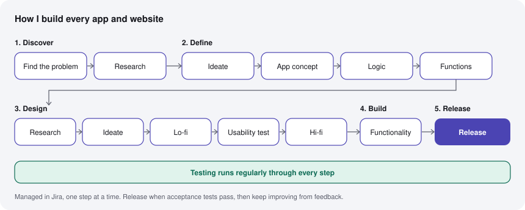

# How I Build

**English** · [한국어](HOW-I-BUILD.ko.md)

I build products by directing AI. I don't write the code myself. I find the problem, plan how the product should work, design it, have the AI (Claude Code and Claude) build it one step at a time, and test every result against what I asked for.

This page shows the process, not the products. The source code stays private.

## My process for every app and website

I run every project in Jira with a stage-gated lifecycle. Each stage has defined deliverables and exit criteria, and the next stage starts only when they are met. The roadmap, backlog and milestones live in Jira.

1. **Discovery:** problem definition → research (users, competitors, technology).
2. **Definition:** ideation → product concept (how the whole app works) → user flows and business logic → functional requirements and architecture.
3. **Design:** starts once the definition is signed off: UX research → ideation → lo-fi wireframes → usability testing → hi-fi.
4. **Build:** incremental delivery, one testable step at a time.
5. **Release:** go-live only when acceptance testing passes, then iteration from feedback.

**QA runs continuously through every stage,** not just at the end.

## How I work inside each step

- **Small, testable steps.** Every step has a clear check: a sound to render, a screen to measure, a test to pass.
- **The AI builds one step at a time,** and I check each result.
- **Automated checks wherever possible:** plugin validation on every build, accessibility scans across every page. My own review covers the rest.
- **Plan ahead.** Each project keeps a roadmap or a backlog of what comes next, with the criteria a stage must meet before the next one starts.
- **Every mistake becomes a rule.** Each issue gets a note: what was wrong, why it was missed, and what to do next time. The notes become a checklist for the next round.

## Case studies

Each case study maps the project onto the steps above.

| Project | What it shows |
|---|---|
| [ZAP + EVOLVE · PVLSE LAB](case-studies/zap-evolve.md) | A working VST plugin built by directing Claude Code: research docs first, a staged spec, test tools, automated macOS and Windows builds |
| [Complete Elixir store](case-studies/complete-elixir-store.md) | A live Shopify store built and refined by directing AI: a brand color audit, measured layouts, accessibility scans, a 32-entry mistake log |
| [ORBIT](case-studies/orbit.md) | A macOS audio app in progress: app concept done, logic and functions nearly done, lo-fi wireframes done, usability testing nearly finished |

## About me

Fenix Jung · Business Administration student at Douglas College (Vancouver, BC)

Audio engineering · UX design · Project management · Building with AI

[pvlselab.com](https://pvlselab.com) · [completeelixir.com](https://completeelixir.com) · [Profile](README.md)
