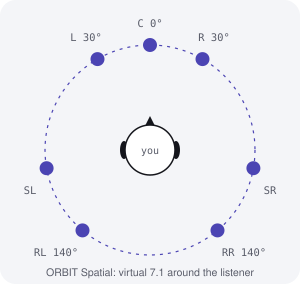
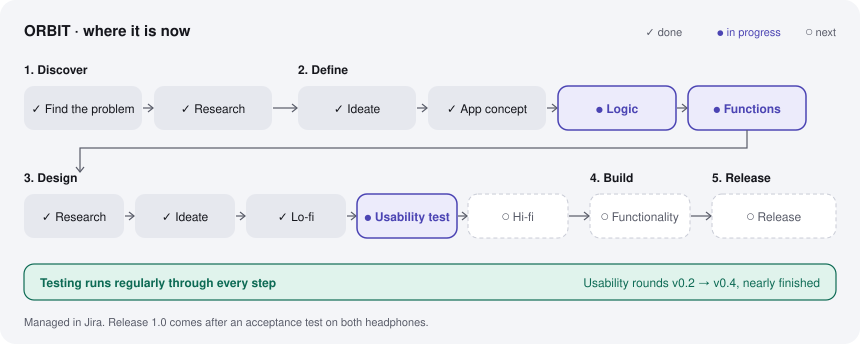
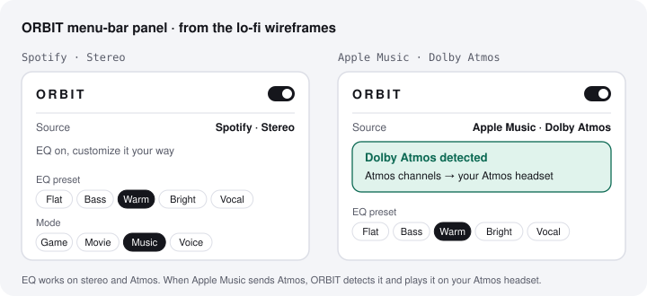

# ORBIT · macOS audio app

**English** · [한국어](orbit.ko.md) · [Back to overview](../HOW-I-BUILD.md)

## Summary

ORBIT is a macOS menu-bar app that adds the EQ macOS doesn't have, for every app.

**The core app:**
- **EQ for any source.** macOS has no built-in system-wide EQ. ORBIT takes the sound from any app, such as Spotify or Apple Music, whether it's stereo or Dolby Atmos, applies EQ, and lets you customize it to sound the way you want.
- **Atmos, automatically.** With Atmos earphones or a headset, ORBIT detects whether Apple Music is sending Dolby Atmos or stereo, and plays the Atmos channels through your earphones or headset on its own.

**Also in the design:**
- **EQ details:** five bands (125 Hz, 250 Hz, 1 kHz, 4 kHz, 8 kHz) plus Bass Boost, with Flat, Bass, Warm, Bright and Vocal presets.
- **Virtual 7.1 spatial sound** for headphones that have none (for example an Xbox headset), with Game, Movie, Music and Voice modes.
- **Device Tune** corrects each headphone first, so a preset sounds the same on every device.

**Signal chain:** Device Tune → EQ → Spatial → Auto level + Limiter (≤ 0 dBFS). The Mac volume stays the master, and ORBIT never makes anything louder than the source.

**Planned stack:** Swift 6 + SwiftUI menu bar, a C++20 real-time audio core, Core Audio process taps. No network access, no analytics.

**My role:** I run ORBIT like a real software product and design it by directing Claude.

## How I build it: step by step, tracked in Jira

Like every project, ORBIT follows my step flow ([see How I Build](../HOW-I-BUILD.md)) in a Jira project, one step at a time, in order. Testing runs regularly through every step, and the app is released only when the acceptance tests pass.

| Stage | Steps | ORBIT now |
|---|---|---|
| 1. Discover | Find the problem → research | Done: the problem from my own headset, device research, the audio-capture approach and the tech stack. |
| 2. Define | Ideate → app concept → logic → functions | App concept done (app structure v0.4, 23 recorded decisions). Logic and functions nearly done. |
| 3. Design | Research → ideate → lo-fi → usability test → hi-fi | Lo-fi wireframes done. Usability testing nearly finished. Hi-fi next. |
| 4. Build | Functionality | Next |
| 5. Release | Acceptance test on both headphones, then daily use | Last |
| Throughout | Regular testing | Usability rounds with fixed questions and pass criteria moved the design from v0.2 to v0.4. |

## Through four lenses

| Lens | What it shows |
|---|---|
| **Project management** | A Jira project run step by step, in order. 23 design decisions recorded in the app structure. An evaluation plan with exit criteria set before the build, such as a blind A/B listening test before Beta ends. |
| **UX design** | Usability rounds with fixed questions and pass criteria moved the design from v0.2 to v0.4. Lo-fi wireframes of the menu-bar panel. The Mac volume stays the master, and ORBIT never plays louder than the source. |
| **Marketing** | Clear positioning: the EQ macOS doesn't have, for every app and any headphones, with Atmos handled automatically. |
| **IT / software** | Planned architecture: Swift 6 + SwiftUI with a C++20 real-time audio core on Core Audio process taps. Audio moves through a lock-free ring buffer, and the build is set to fail if the audio thread locks or allocates memory. Settings glide over 20–50 ms so changes never click. EQ uses RBJ biquad filters in double precision, and a limiter keeps the output at or below 0 dBFS. If ORBIT crashes, macOS un-mutes the original audio on its own. |

### An open problem, written down

The automatic Atmos switch depends on knowing what Apple Music is sending, and there is no public API for it. Candidate signals: the Music app's output channel count and format, the system renderer path, and now-playing metadata. If none of them works, the fallback is a per-app rule.

## How it will be evaluated

- Usability rounds with fixed questions and pass criteria, run regularly.
- End-to-end latency measured on both headphones before the engine design is locked.
- Blind, level-matched A/B listening tests for the spatial modes (Beta exit).
- An acceptance test against written criteria before the release.
